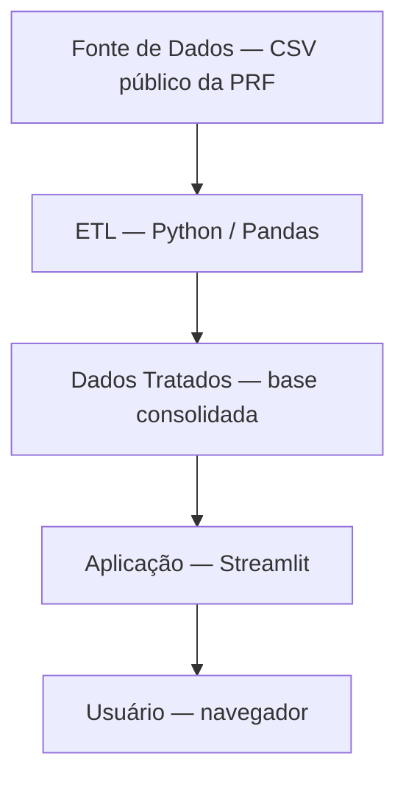

# Arquitetura e Produto — MAPPA

> Documento completo (arquitetura da informação, testes de integração, protótipo de baixo nível, storyboard): [Artefato 3 — Gestão do Produto](../entregas/Artefato_3_Gestao_Produto_MAPPA.docx).

## Mapa de telas

| Tela | Conteúdo principal | Requisitos |
|---|---|---|
| Visão Geral | Indicadores consolidados | RF02 |
| Gráficos | Distribuição por causa, horário e período | RF03 |
| Ranking | Rodovias com maior número de ocorrências | RF04 |
| Mapa | Distribuição geográfica das ocorrências | RF05 |
| Filtros (lateral) | Rodovia, período, causa, severidade | RF01, RF07 |
| Sobre | Fonte dos dados e metodologia | RNF05 |

## Arquitetura em camadas

| Camada | Responsabilidade | Tecnologia |
|---|---|---|
| Fonte de Dados | Arquivos CSV públicos da PRF | Dados abertos |
| ETL | Extração, limpeza, padronização | Python, Pandas |
| Dados Tratados | Base consolidada e filtrável | Parquet / CSV tratado |
| Aplicação | Filtros, indicadores, gráficos, mapa | Streamlit, Plotly/Folium |
| Apresentação | Interface web | Navegador |

## Testes de integração (resumo)

| ID | Cenário | Resultado esperado |
|---|---|---|
| TI01 | ETL gera saída consumível pelo dashboard | Schema da base tratada correto |
| TI02 | Indicadores refletem dados tratados | Totais batem com a base tratada |
| TI03 | Filtro de rodovia integra corretamente | Apenas registros filtrados são exibidos |
| TI04 | Filtros combinados | Interseção correta entre filtros |
| TI05 | Mapa reflete recorte geográfico | Mapa centralizado na rodovia selecionada |
| TI06 | Tratamento de dados incompletos | Pipeline não quebra com dados nulos |

---
🔗 Ver também: [Requisitos](./requisitos.md) · [EAP](./eap.md) · [Análise de Usuário](./analise-usuario.md)
