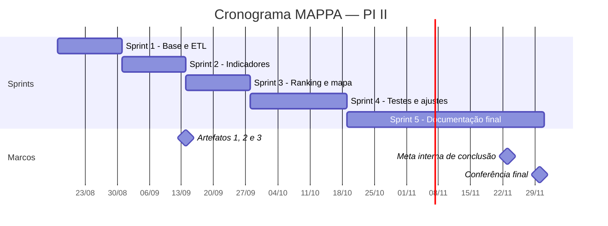

# Cronograma em Sprints — MAPPA

## Planejamento geral

O projeto MAPPA — PI II está organizado em cinco Sprints, com duas reuniões previstas por Sprint, totalizando dez reuniões.

**Meta interna de conclusão:** 23/11/2026.
**Prazo final de conferência:** 30/11/2026.
**Dezembro:** sem atividades ou entregas planejadas.

**Marco acadêmico:** entrega prevista dos Artefatos 1, 2 e 3 em 14/09/2026, conforme a EAP.

As datas das Sprints representam o planejamento do projeto. Reuniões realizadas devem ser comprovadas por atas em `./reunioes/`.

## Sprint 1 — Revisão e consolidação da base 

**Período proposto:** 17/08 a 30/08/2026.
**Aulas relacionadas:** 17 e 24/08.
**Foco:** Revisão do ETL herdado do PI I; levantamento e validação de requisitos.
**Itens do backlog:** [US03](./backlog.md#us03).
**Entregas previstas:** Requisitos validados, backlog priorizado e ETL revisado.

**Reuniões previstas:**
- Reunião 1 — Planejamento da Sprint.
- Reunião 2 — Revisão e retrospectiva.

## Sprint 2 — Indicadores e gráficos básicos 

**Período proposto:** 31/08 a 13/09/2026.
**Aula relacionada:** 31/08.
**Foco:** Indicadores consolidados e gráficos básicos do dashboard.
**Itens do backlog:** [US01](./backlog.md#us01), [US02](./backlog.md#us02), [US06](./backlog.md#us06).
**Entregas previstas:** RF01, RF02 e RF03.

**Reuniões previstas:**
- Reunião 1 — Planejamento da Sprint.
- Reunião 2 — Revisão e retrospectiva.

## Sprint 3 — Ranking, mapa e filtros avançados 

**Período proposto:** 14/09 a 27/09/2026.
**Aulas relacionadas:** 14 e 21/09.
**Foco:** Ranking de rodovias, mapa geográfico e filtros combinados.
**Itens do backlog:** [US04](./backlog.md#us04), [US05](./backlog.md#us05), [US07](./backlog.md#us07).
**Entregas previstas:** RF04, RF05 e RF07.

**Marco:** entrega acadêmica prevista dos Artefatos 1, 2 e 3 em 14/09.

**Reuniões previstas:**
- Reunião 1 — Planejamento da Sprint.
- Reunião 2 — Revisão e retrospectiva.

## Sprint 4 — Testes, ajustes e manutenibilidade 

**Período proposto:** 28/09 a 18/10/2026.
**Aulas relacionadas:** 28/09 e 05/10.
**Foco:** Testes de integração, desempenho, usabilidade e modularização do código.
**Itens do backlog:** [US08](./backlog.md#us08), [US09](./backlog.md#us09).
**Entregas previstas:** Validação dos RNF01, RNF02 e RNF04 e correções de bugs.

**Reuniões previstas:**
- Reunião 1 — Planejamento da Sprint.
- Reunião 2 — Revisão e retrospectiva.

## Sprint 5 — Documentação final e apresentação 

**Período proposto:** 19/10 a 30/11/2026.
**Aulas relacionadas:** 19 e 26/10; 09, 16 e 23/11.
**Foco:** Consolidação da documentação, organização dos artefatos, validação final e apresentação.
**Itens do backlog:** US10, US11 e US13 — propostas para avaliação da equipe, sem implementação ou entrega confirmada.
**Entregas previstas:** Documentação consolidada, evidências de testes, artefatos e apresentação final.

**Reuniões previstas:**
- Reunião 1 — Planejamento da Sprint.
- Reunião 2 — Revisão e retrospectiva.

**Marcos internos:**
- 23/11 — Meta de conclusão das atividades.
- 24 a 30/11 — Conferência e eventuais correções finais.

---

## Visão gráfica

---

Ver também: [Requisitos](./requisitos.md) · [Backlog](./backlog.md)
